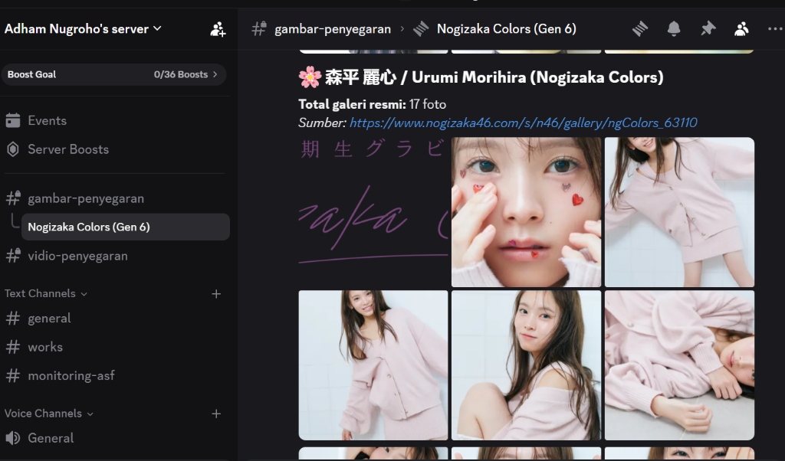
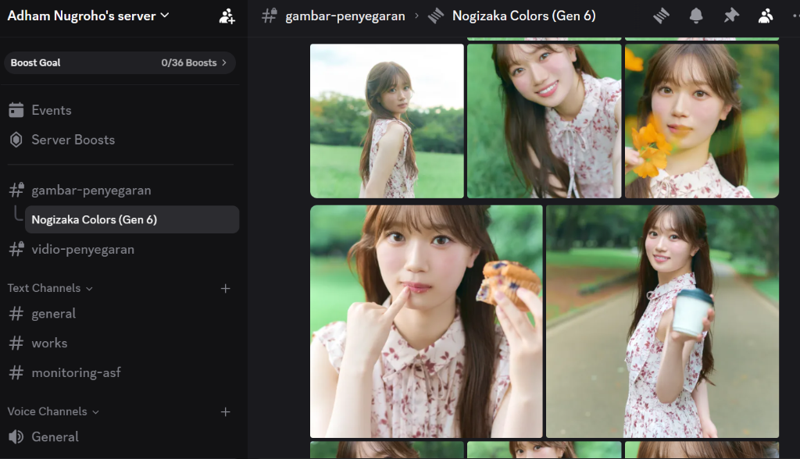
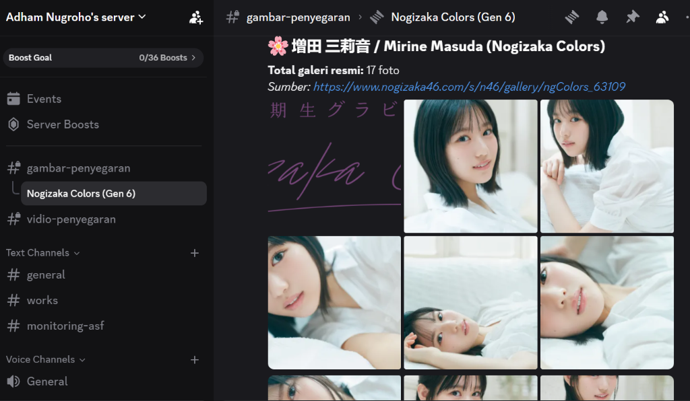
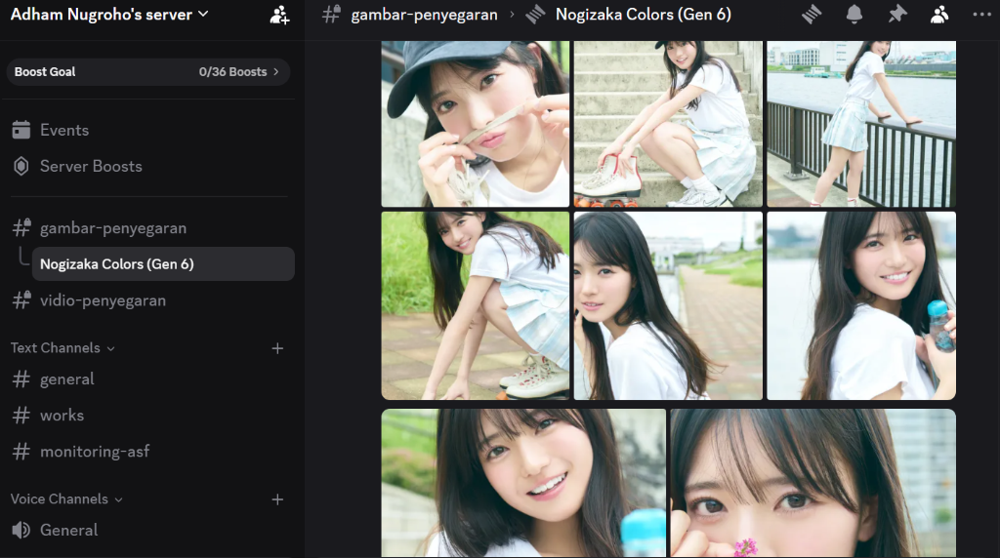
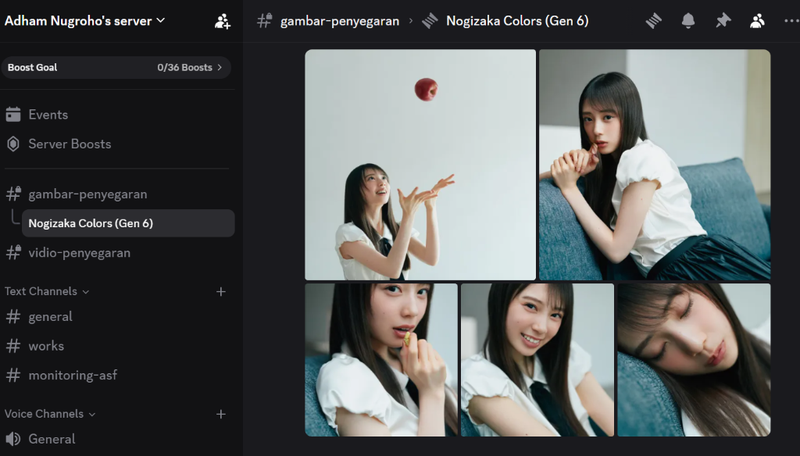

# 🌸 Nogizaka Colors Discord Uploader

[](https://www.python.org/)
[](LICENSE)
[](https://discord.com/developers/docs/resources/webhook)
[](https://www.nogizaka46.com/)
[](.github/workflows/code-quality.yml)

Pipeline otomatisasi berbasis Python untuk mengikis (*scrape*) seluruh galeri foto resmi beresolusi tinggi dari kampanye **Nogizaka Colors (Nogizaka46 Generasi ke-6)** dan mengarsipkannya secara rapi, berurutan, serta bebas kompresi ke dalam **Discord Thread** melalui Webhooks.

---

## 📑 Daftar Isi

- [Latar Belakang & Analisis Masalah](#-latar-belakang--analisis-masalah)
- [Showcase Bukti Pengujian Live Discord](#-showcase-bukti-pengujian-live-discord)
- [Arsitektur & Alur Kerja Teknis](#-arsitektur--alur-kerja-teknis)
- [Daftar 11 Member Generasi ke-6](#-daftar-11-member-generasi-ke-6)
- [Panduan Instalasi & Eksekusi](#-panduan-instalasi--eksekusi)
  - [Metode 1: Modular Engine (Direkomendasikan)](#metode-1-modular-engine-direkomendasikan)
  - [Metode 2: Standalone Runner (Satu Berkas Mandiri)](#metode-2-standalone-runner-satu-berkas-mandiri)
- [Panduan Adaptasi untuk Event / Idol Lain](#-panduan-adaptasi-untuk-event--idol-lain)
- [Mitigasi Teknis Jaringan](#-mitigasi-teknis-jaringan)
- [Struktur Repositori](#-struktur-repositori)
- [Keamanan & Praktik Terbaik](#-keamanan--praktik-terbaik)
- [Lisensi](#-lisensi)

---

## 🔍 Latar Belakang & Analisis Masalah

Situs resmi [Nogizaka Colors](https://www.nogizaka46.com/s/n46/page/nogizaka_colors) merilis kampanye perkenalan 11 anggota baru Generasi ke-6 Nogizaka46. Setiap anggota memiliki galeri foto eksklusif beresolusi tinggi sebanyak 17 foto, dengan total keseluruhan **187 foto (~220 MB)**.

Pengarsipan manual ke platform komunitas seperti Discord memunculkan tiga kendala utama:

1. **Kesalahan Terjemahan Mesin (Browser Machine Translation Glitch)**:  
   Fitur terjemahan otomatis browser (Google Translate / DeepL) menerjemahkan Kanji nama member secara harfiah sehingga menghasilkan ejaan yang keliru:
   - 大越 ひなの -> Diterjemahkan salah: *"Hino Koshi"* (Resmi: **Hinano Okoshi**)
   - 森平 麗心 -> Diterjemahkan salah: *"Raisin Morihira"* (Resmi: **Urumi Morihira**)
   - 長嶋 凛桜 -> Diterjemahkan salah: *"Nagashima Reno"* (Resmi: **Rio Nagashima**)  
   *Sistem ini menggunakan basis data identitas resmi yang telah divalidasi.*

2. **Limitasi Payload Discord (HTTP 413 - Payload Too Large)**:  
   Discord membatasi upload gratis per pesan maksimal ~8-10 MB. Mengunggah 10 foto resolusi tinggi sekaligus sering menyebabkan pesan ditolak mentah-mentah oleh server Discord.

3. **Limitasi Laju Permintaan (HTTP 429 - Rate Limiting)**:  
   Mengunggah ratusan media secara beruntun memicu rate limit Discord. Tanpa jeda adaptif, skrip akan terputus di tengah jalan.

Repositori ini hadir sebagai solusi rekayasa teruji untuk mengatasi seluruh kendala tersebut secara otomatis.

---

## 📸 Showcase Bukti Pengujian Live Discord

Berikut adalah 5 bukti tangkapan layar live dari server Discord (Channel `#gambar-penyegaran` -> Thread `Nogizaka Colors (Gen 6)`):

| Screenshot | Subjek & Identitas Member | Analisis Tampilan & Peran Dokumentasi |
|:---:|:---|:---|
|  | **森平 麗心 / Urumi Morihira**<br>`ID: 63110` | **Header Identitas & Grid Layout**:<br>Menampilkan pesan pengantar beremotikon sakura, ringkasan jumlah foto (17 foto), tautan galeri resmi, serta tampilan multi-image grid Discord yang rapi. |
|  | **小津 玲奈 / Reina Ozu**<br>`ID: 63103` | **Kualitas Media Tanpa Kompresi Rusak**:<br>Menunjukkan foto bertema outdoor beresolusi penuh tanpa penurunan kualitas (*lossless in-memory delivery*). |
|  | **増田 三莉音 / Mirine Masuda**<br>`ID: 63109` | **Konsistensi Format Pesan**:<br>Struktur pesan terstandarisasi untuk setiap member memudahkan pencarian arsip di dalam thread. |
|  | **長嶋 凛桜 / Rio Nagashima**<br>`ID: 63108` | **Dynamic Smart Batching**:<br>Pembagian batch cerdas (Batch 2: 6 foto tema sepatu roda) yang tampil simetris pada antarmuka Discord. |
|  | **矢田 萌華 / Moeka Yada**<br>`ID: 63111` | **Integritas Penutupan Galeri**:<br>Pengiriman batch terakhir (Batch 3: 5 foto tema santai apel) yang menggenapkan seluruh 187 foto tanpa ada berkas tertinggal. |

---

## 🏗️ Arsitektur & Alur Kerja Teknis

```
[ Situs Resmi nogizaka46.com ]
                │
                ▼ (HTTP GET dengan browser User-Agent)
┌────────────────────────────────────────────────────────┐
│  Scraper Engine (Python Built-in HTMLParser)           │
│  - Ekstraksi tag  & data-src                      │
│  - Filter /images/46/ (eliminasi logo, banner, OGP)    │
└────────────────────────────────────────────────────────┘
                │
                ▼ (URL Foto Resolusi Tinggi)
┌────────────────────────────────────────────────────────┐
│  In-Memory Streamer (Bytes Buffer)                     │
│  - Unduh langsung ke RAM (0 bytes residu disk)         │
│  - Dynamic Smart Batching (< 8.5 MB atau maks 6 foto)  │
└────────────────────────────────────────────────────────┘
                │
                ▼ (Multipart Form-Data POST)
┌────────────────────────────────────────────────────────┐
│  Discord Webhook Engine                                │
│  - Parameter thread: ?thread_id={ID}                   │
│  - Auto-Split Bisector jika HTTP 413                   │
│  - Linear Backoff jika HTTP 429 (retry_after)          │
└────────────────────────────────────────────────────────┘
                │
                ▼
[ Discord Thread: Nogizaka Colors (Gen 6) ]
```

Selengkapnya mengenai keputusan desain teknis dapat dibaca pada [docs/ARCHITECTURE.md](docs/ARCHITECTURE.md).

---

## 👥 Daftar 11 Member Generasi ke-6

| No | Nama Kanji | Nama Romaji Resmi | ID Galeri | Total Foto | Distribusi Batch Discord |
|:---:|:---|:---|:---:|:---:|:---|
| 1 | 大越 ひなの | **Hinano Okoshi** | `63102` | 17 | Batch 1 (6), Batch 2 (6), Batch 3 (5) |
| 2 | 海邉 朱莉 | **Akari Kaibe** | `63104` | 17 | Batch 1 (6), Batch 2 (6), Batch 3 (5) |
| 3 | 鈴木 佑捺 | **Yuna Suzuki** | `63106` | 17 | Batch 1 (6), Batch 2 (6), Batch 3 (5) |
| 4 | 森平 麗心 | **Urumi Morihira** | `63110` | 17 | Batch 1 (6), Batch 2 (6), Batch 3 (5) |
| 5 | 小津 玲奈 | **Reina Ozu** | `63103` | 17 | Batch 1 (6), Batch 2 (6), Batch 3 (5) |
| 6 | 長嶋 凛桜 | **Rio Nagashima** | `63108` | 17 | Batch 1 (6), Batch 2 (6), Batch 3 (5) |
| 7 | 愛宕 心響 | **Kokone Atago** | `63101` | 17 | Batch 1 (6), Batch 2 (5), Batch 3 (4), Batch 4 (2)* |
| 8 | 川端 晃菜 | **Hina Kawabata** | `63105` | 17 | Batch 1 (6), Batch 2 (6), Batch 3 (5) |
| 9 | 増田 三莉音 | **Mirine Masuda** | `63109` | 17 | Batch 1 (6), Batch 2 (6), Batch 3 (5) |
| 10 | 瀬戸口 心月 | **Mitsuki Setoguchi** | `63107` | 17 | Batch 1 (6), Batch 2 (6), Batch 3 (5) |
| 11 | 矢田 萌華 | **Moeka Yada** | `63111` | 17 | Batch 1 (6), Batch 2 (6), Batch 3 (5) |
| **Total** | **11 Member** | | | **187** | **45 Pesan (11 Header + 34 Batch Media)** |

*\*Catatan: Member Kokone Atago terdistribusi menjadi 4 batch karena variasi ukuran byte file foto individual yang mendekati ambang batas aman 8.5 MB.*

---

## 🚀 Panduan Instalasi & Eksekusi

### Prasyarat
- Python 3.10 atau versi lebih baru.
- Webhook Discord yang memiliki izin mengirim pesan dan berkas ke channel/thread tujuan.

---

### Metode 1: Modular Engine (Direkomendasikan)

Metode ini menggunakan arsitektur bersih di folder `src/` dan konfigurasi berkas `.env`.

1. **Clone repositori**:
   ```bash
   git clone https://github.com/adhamnugroho/nogizaka-colors-discord-uploader.git
   cd nogizaka-colors-discord-uploader
   ```

2. **Pasang dependensi**:
   ```bash
   pip install -r requirements.txt
   ```

3. **Konfigurasi Lingkungan (`.env`)**:
   Salin template `.env.example` menjadi `.env`:
   ```bash
   cp .env.example .env
   # Di Windows PowerShell:
   # Copy-Item .env.example .env
   ```
   Buka berkas `.env` dan isi dengan URL Webhook Anda:
   ```env
   DISCORD_WEBHOOK_URL=https://discord.com/api/webhooks/123456789012345678/your_actual_token
   DISCORD_THREAD_ID=1561792308255391844
   ```

4. **Validasi Awal (Dry-Run)**:
   Periksa ketersediaan galeri tanpa mengirim apa pun ke Discord:
   ```bash
   python main.py --dry-run
   ```

5. **Jalankan Pengarsipan Penuh**:
   ```bash
   python main.py
   ```

#### Opsi Parameter Baris Perintah (`main.py`):
```text
  --webhook-url URL      Mengabaikan nilai DISCORD_WEBHOOK_URL dari .env
  --thread-id ID         Mengabaikan nilai DISCORD_THREAD_ID dari .env
  --member-id ID         Hanya memproses 1 member tertentu (contoh: --member-id 63110)
  --dry-run              Uji coba scraping tanpa upload ke Discord
  --delay DETIK          Jeda antar pengiriman batch (default: 2.0 detik)
```

---

### Metode 2: Standalone Runner (Satu Berkas Mandiri)

Jika Anda ingin menjalankan pipeline di mesin lain tanpa konfigurasi virtualenv atau berkas tambahan:

```bash
python scripts/standalone_uploader.py
```
Skrip akan secara interaktif meminta URL Webhook dan Thread ID jika belum terdeteksi di *environment variables*.

---

### Menjalankan Unit Test Suite

Repositori dilengkapi dengan rangkaian pengujian unit otomatis (*automated test suite*) berbasis `unittest` standar tanpa dependensi tambahan untuk memverifikasi fungsionalitas parser scraper, validasi konfigurasi, MIME-type mapping, mitigasi rate limit 429, serta auto-split bisection 413:

```bash
python -m unittest discover -s tests -p "test_*.py" -v
```

---

## 🔄 Panduan Adaptasi untuk Event / Idol Lain

Pipeline ini dirancang fleksibel agar dapat digunakan kembali untuk event Nogizaka46 mendatang atau grup idol lainnya (Sakurazaka46, Hinatazaka46, dsb.):

1. **Mengubah Pola URL Galeri**  
   Buka `src/config.py` dan sesuaikan konstanta `GALLERY_URL_TEMPLATE`:
   ```python
   # Contoh adaptasi untuk kampanye baru:
   GALLERY_URL_TEMPLATE = "https://www.nogizaka46.com/s/n46/gallery/specialEvent_{member_id}"
   ```

2. **Menyesuaikan Filter Scraping**  
   Buka `src/scraper.py` pada fungsi `extract_photo_urls`:
   ```python
   # Sesuaikan path direktori CDN foto grup target:
   if "/images/46/" in lower_url and not any(kw in lower_url for kw in ignored_keywords):
       filtered_urls.append(full_url)
   ```

3. **Memperbarui Metadata Member**  
   Perbarui list `MEMBERS` pada `src/config.py` dengan ID halaman, Kanji, dan Romaji resmi grup target.

---

## 🛡️ Mitigasi Teknis Jaringan

- **In-Memory Streaming**: Seluruh foto diunduh langsung sebagai *byte buffer* di RAM. Setelah payload multipart berhasil dikirim ke Discord, buffer dibersihkan oleh garbage collector. Nol residu berkas di disk lokal.
- **Dynamic Smart Batching**: Setiap batch dihitung secara dinamis: jika penambahan berkas baru akan melebihi 6 foto atau 8.5 MB, batch saat itu langsung dikirim terlebih dahulu.
- **Auto-Split Bisector (413)**: Jika server Discord menolak pesan karena batas payload terlampaui, sistem secara rekursif membagi batch menjadi dua bagian dan mengirimkannya secara berurutan dengan teks caption tetap terjaga.
- **Adaptive Rate Limit Backoff (429)**: Ketika Discord mengembalikan status 429, klien membaca nilai `retry_after` dari payload JSON Discord dan menunda pengiriman secara presisi.

---

## 📁 Struktur Repositori

```text
nogizaka-colors-discord-uploader/
├── .github/
│   └── workflows/
│       └── code-quality.yml          # CI linting, compile check & unittest
├── assets/
│   └── screenshots/                  # 5 Bukti visual live testing Discord
│       ├── 01_urumi_morihira_header.png
│       ├── 02_reina_ozu_outdoor_grid.png
│       ├── 03_mirine_masuda_header.png
│       ├── 04_rio_nagashima_skater_grid.png
│       └── 05_moeka_yada_apple_batch_end.png
├── docs/
│   ├── ARCHITECTURE.md               # Dokumentasi teknis arsitektur & Discord Webhook
│   └── PANDUAN_ASLI_GEMINI.md        # Catatan historis alur awal sesi Gemini Canvas
├── scripts/
│   ├── standalone_uploader.py        # Versi mandiri zero-dependency (1 file siap pakai)
│   └── original_canvas_script.py     # Arsip skrip prototipe awal Gemini Canvas
├── src/
│   ├── __init__.py                   # Package metadata
│   ├── config.py                     # Konfigurasi lingkungan & daftar 11 member
│   ├── scraper.py                    # Parser HTML & downloader foto in-memory
│   └── discord_client.py             # Klien multipart webhook dengan mitigasi 413/429
├── tests/
│   ├── __init__.py                   # Package test runner
│   ├── test_cli.py                   # Pengujian CLI argument parser & error codes
│   ├── test_config.py                # Pengujian konfigurasi & koreksi nama romaji
│   ├── test_discord_client.py        # Pengujian URL, MIME, 413 bisection & 429 retry
│   └── test_scraper.py               # Pengujian HTML parser & filtering gambar
├── .env.example                      # Template variabel lingkungan aman
├── .gitignore                        # Proteksi secret & cache lokal
├── LICENSE                           # Lisensi MIT
├── main.py                           # Entrypoint CLI pipeline modular
├── requirements.txt                  # Dependensi minimal (requests, python-dotenv)
└── README.md                         # Dokumentasi utama proyek
```

---

## 🔒 Keamanan & Praktik Terbaik

- **Jangan Pernah Meng-commit Token Webhook**: Berkas `.env` telah didaftarkan pada `.gitignore`. Jika URL Webhook Anda sempat terekspos ke publik, segera hapus atau reset webhook tersebut melalui *Server Settings -> Integrations -> Webhooks*.
- **Etika Scraping**: Skrip ini menggunakan jeda waktu (*polite delay*) antar permintaan halaman untuk menghindari beban berlebih pada server web Nogizaka46.

---

## 📜 Lisensi

Proyek ini dirilis di bawah lisensi [MIT License](LICENSE).  
Hak cipta foto dan materi promosi sepenuhnya milik **Seed & Flower LLC / Sony Music Labels Inc. / Nogizaka46 LLC**. Proyek ini dibuat semata-mata untuk tujuan dokumentasi teknis dan pengarsipan non-komersial.
